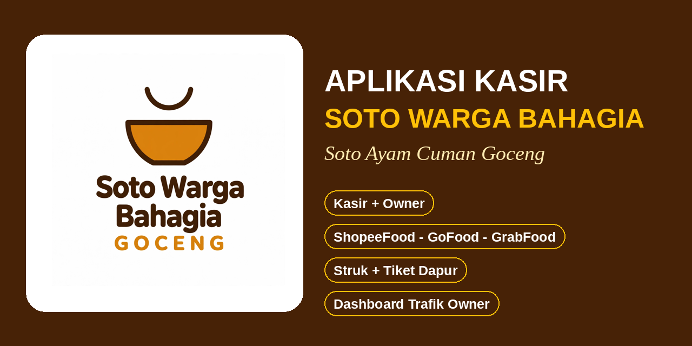
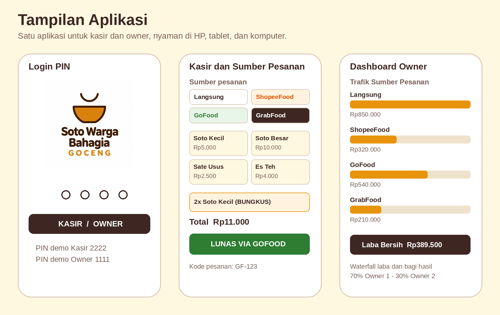
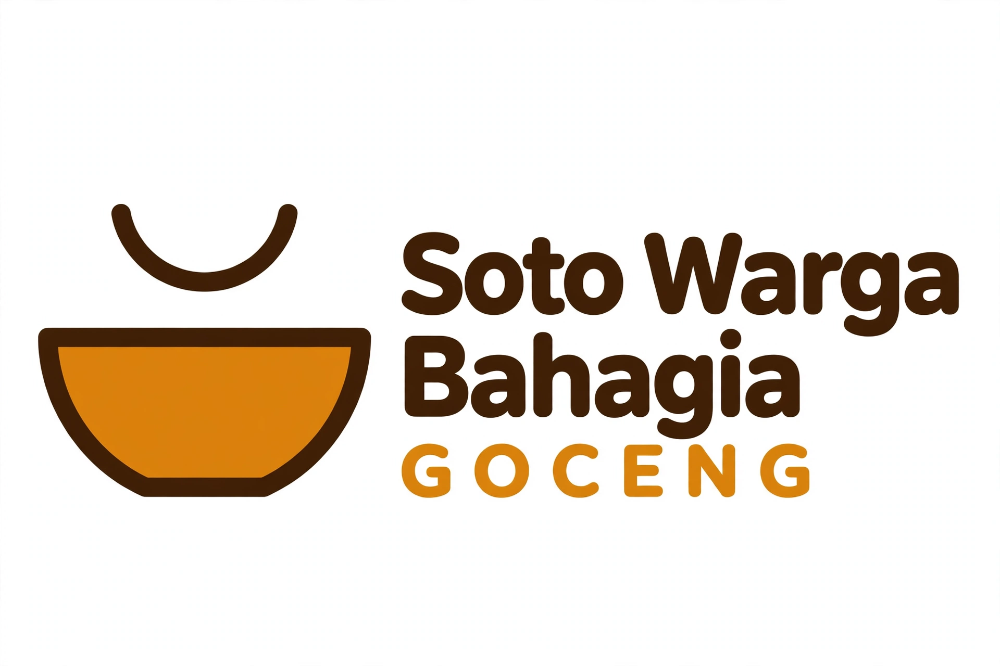

# Aplikasi Kasir Soto Warga Bahagia



Aplikasi kasir (point of sale) berbasis web untuk warung **Soto Warga Bahagia**, Villa Pamulang, Tangerang Selatan, dengan tagline produk **Soto Ayam Cuman Goceng**. Aplikasi ini dirancang untuk warung bervolume tinggi dan harga terjangkau: kasir bekerja cepat dari HP atau tablet, sementara owner memantau laba dan trafik penjualan dari perangkat yang sama.

Aplikasi berjalan dari **satu file HTML** tanpa instalasi dan tanpa server. Setelah halaman terbuka, aplikasi dapat dipakai secara offline karena seluruh program dan data tersimpan di browser perangkat.

**Coba langsung:** https://andikapratamazaid.github.io/kasir-soto-warga-bahagia/aplikasi-kasir-soto.html

| Peran | PIN demo | Akses |
| --- | --- | --- |
| Owner | 1111 | Semua fitur kasir, dashboard, menu, karyawan, laporan, pengaturan |
| Kasir Admin | 9999 | Jualan, pengeluaran, buka dan tutup shift. Akun non karyawan: tidak tercatat di kehadiran dan gaji |
| Karyawan (Sari) | 3333 | Login di bagian Kasir dengan PIN pribadi. Otomatis tercatat absen masuk beserta jamnya |
| Karyawan (Budi) | 4444 | Sama seperti di atas, dengan PIN pribadinya sendiri |

Setiap karyawan yang ditambahkan owner mendapat PIN login sendiri, dan PIN dapat diubah owner dari halaman Karyawan.

Di HP, buka tautan di atas lalu pilih menu browser **Tambahkan ke Layar Utama** agar aplikasi tampil seperti aplikasi biasa.



## Fitur Kasir

- **Layar jualan cepat.** Menu tampil sebagai tombol besar dalam 38 item dan 6 kategori: Soto, Sate, Gorengan, Pendamping, dan Minuman, plus kategori Semua. Targetnya maksimal tiga sentuhan dari memilih menu sampai lunas.
- **Login pribadi dan absen otomatis.** Di bagian Kasir, setiap karyawan masuk dengan PIN pribadinya dan kehadirannya hari itu tercatat otomatis lengkap dengan jam masuk, tanpa perlu absen terpisah. Di luar karyawan ada akun **Kasir Admin** untuk petugas non karyawan. Owner melihat siapa yang sudah masuk dan siapa yang belum dari halaman Karyawan dan dashboard.
- **Empat sumber pesanan.** Setiap transaksi dicatat sumbernya: **Langsung**, **ShopeeFood**, **GoFood**, atau **GrabFood**. Tiga tombol platform tampil sebagai logo resminya saja agar kasir mengenalinya sekilas tanpa membaca teks.
- **Pesanan online yang rapi.** Bila sumbernya platform online, semua item otomatis dibungkus dan terkunci, tersedia kolom kode pesanan platform, dan pembayaran diselesaikan dengan tombol **Lunas Via Platform** karena pembeli membayar di aplikasi platform, bukan di laci warung.
- **Makan di sini dan dibungkus bisa campuran.** Pengaturan berlaku per item, bahkan per porsi di dalam item yang sama. Contoh: Soto Kecil dipesan 2, satu dibungkus dan satu makan di sini. Biaya plastik Rp1.000 hanya dikenakan per jenis soto yang dibungkus. Item lain yang dibungkus, seperti sate, gorengan, dan minuman, tidak dihitung biaya bungkusnya. Besaran biaya dapat diubah owner di Pengaturan.
- **Nomor antrian harian.** Nomor berjalan mulai 001, berlanjut antar shift di hari yang sama, dan mulai lagi dari awal pada hari berikutnya.
- **Struk pembeli dan tiket dapur.** Format kertas thermal 58 mm. Struk memuat logo hitam resmi, nomor antrian besar, sumber pesanan, **nama kasir yang bertugas**, rincian item, total, pembayaran, dan kembalian. Tiket dapur tanpa harga, berhuruf besar, mencantumkan nama kasir juga, dan untuk pesanan online berkepala nama platform beserta kodenya agar mudah dicocokkan dengan pengemudi.
- **Pembayaran tunai dan QRIS.** Tunai memakai nominal cepat dan hitung kembalian otomatis. QRIS mencatat nomor referensi. Penjualan QRIS dan online tidak ikut dihitung sebagai uang laci.
- **Pengeluaran berkategori.** Kasir wajib memilih kategori Bahan atau Operasional terlebih dahulu. Bahan dipilih dari daftar 28 bahan acuan, dan pengeluaran bahan inilah yang menjadi biaya bahan aktual pada hitungan laba.
- **Status HABIS.** Item yang habis dapat ditandai langsung dari layar jualan, tampil abu-abu dan tidak bisa dipilih, lalu segar kembali otomatis saat shift pertama hari berikutnya dibuka, kecuali owner menetapkannya tetap habis.
- **Buka dan tutup shift, plus ganti shift.** Setiap petugas membuka shift dengan modal awal atas namanya sendiri, dan jam buka shift tercatat dan tampil di layar. Menutup shift memakai hitungan uang fisik dengan selisih kas otomatis. Tombol **Ganti Shift** menutup shift petugas saat ini lalu mengembalikan aplikasi ke layar login agar petugas berikutnya masuk dengan PIN-nya dan membuka shift baru. Nomor antrian tetap berlanjut. Satu hari dapat terdiri dari beberapa shift.

## Fitur Owner

- **Dashboard waterfall laba.** Omzet dikurangi biaya bahan aktual dari input kasir, biaya operasional, dan beban gaji akrual harian. Hasilnya adalah laba bersih. Tabungan warung sebesar 10 persen dari omzet diambil maksimal sebesar laba bersih, dan sisanya dibagi Owner 1 sebesar 70 persen dan Owner 2 sebesar 30 persen. Bila rugi, tabungan nol dan kerugian dibagi dengan proporsi yang sama. HPP standar per porsi hanya tampil sebagai pembanding agar tidak terjadi penghitungan ganda.
- **Trafik sumber pesanan.** Kartu khusus menampilkan omzet dan jumlah order hari ini untuk Langsung, ShopeeFood, GoFood, dan GrabFood secara berdampingan. Omzet platform adalah nilai pesanan yang tercatat di kasir, sebelum potongan komisi masing-masing platform.
- **Trafik produk.** Produk terlaris, produk belum laku, dan daftar item yang sedang habis. Penjualan dari semua sumber, termasuk platform online, ikut terhitung sehingga menu yang laku lewat aplikasi tetap terbaca.
- **Grafik omzet 7 hari terakhir** dan status rekap harian: Belum Final selama masih ada shift terbuka, Final setelah shift terakhir ditutup.
- **Kelola menu.** Owner dapat menambah menu baru lengkap dengan resep bahan. Sistem menghitung HPP standar dan menampilkan status margin UNTUNG, TIPIS, atau RUGI sebelum menu disimpan. Menu dapat dinonaktifkan tanpa menghapus riwayat penjualan.
- **Karyawan dan gaji.** Owner dapat menambahkan karyawan baru lengkap dengan jabatan, skema gaji, tarif, dan PIN login kasirnya. Gaji diakrual otomatis setiap hari: skema harian berdasarkan kehadiran, skema bulanan dibagi 26 hari kerja. Setiap karyawan juga memiliki hitungan jumlah masuk bulan ini dan total keseluruhan, tanggal terakhir masuk, status masuk atau belum masuk hari ini beserta jamnya, serta perkiraan gaji bulan ini (tarif dikali jumlah masuk untuk skema harian). Ringkasan kehadiran hari ini tampil di dashboard owner, dan rincian jumlah masuk ikut terbawa di Sheet Gaji Karyawan.
- **Riwayat dan void.** Semua transaksi hari ini tampil dengan metode, tipe, dan kode platformnya. Void wajib mengisi alasan dan tetap tercatat.
- **Unduh sheet owner.** Enam sheet CSV sesuai tab aslinya: Ringkasan, Penjualan, Bahan-bahan, Operasional, Gaji Karyawan, dan Produk. Sheet Penjualan memuat kolom Sumber dan Kode Platform, dan Sheet Ringkasan memuat omzet per sumber pesanan.
- **Pengaturan.** Nama warung, alamat struk, teks kaki struk, persentase tabungan, persentase Owner 1, dan biaya bungkus dapat diubah owner.

## Alur Pemakaian

**Penjualan langsung**

1. Kasir masuk dengan PIN dan membuka shift beserta modal awal.
2. Pilih sumber **Langsung**, ketuk menu, atur makan di sini atau dibungkus per item bila perlu.
3. Tekan Tunai atau QRIS, selesaikan pembayaran, lalu cetak struk dan tiket dapur.

**Penjualan platform online**

1. Pesanan masuk di aplikasi ShopeeFood, GoFood, atau GrabFood seperti biasa.
2. Di aplikasi kasir, pilih sumber platformnya, isi kode pesanan dari aplikasi platform, lalu masukkan item yang sama. Semua item otomatis terbungkus.
3. Tekan **Lunas Via Platform**. Tiket dapur tercetak berkepala nama platform dan kodenya, siap dicocokkan saat pengemudi datang.
4. Penjualan tercatat di omzet, trafik produk, dan trafik sumber pesanan owner, tetapi tidak dihitung sebagai kas laci dan tidak masuk rekonsiliasi uang fisik.

**Tutup hari**

1. Setiap kasir menutup shiftnya dan mencocokkan uang fisik.
2. Setelah shift terakhir tutup, rekap harian berstatus Final dan dashboard owner menampilkan laba bersih, tabungan, serta bagian masing-masing owner.

## Teknologi

- Satu file `aplikasi-kasir-soto.html` berisi HTML, CSS, dan JavaScript murni. Tanpa framework, tanpa build, tanpa dependensi eksternal.
- Data tersimpan di `localStorage` browser dengan kunci `pos_swb_v1`.
- Tampilan responsif: satu kolom di HP dan tablet potret, dua kolom (menu dan keranjang 340 px) di layar di atas 820 px, lebar konten maksimal 1.100 px di komputer.
- Pencetakan memakai dialog print browser dengan area cetak khusus struk dan tiket dapur 58 mm.
- Dihosting statis dengan GitHub Pages dari repository ini.

## Struktur Repository

```
kasir-soto-warga-bahagia/
  aplikasi-kasir-soto.html   Aplikasi kasir lengkap dalam satu file
  README.md                  Dokumentasi ini
  docs/
    img/
      banner.png             Banner utama repository
      visual-desain.png      Visual desain tiga layar utama
      logo-utama.png         Logo resmi versi horizontal
```

## Batasan Saat Ini

- Data tersimpan lokal di browser masing-masing perangkat, sehingga transaksi di HP kasir belum otomatis tampil di HP atau komputer owner. Gunakan satu perangkat yang sama untuk kasir dan pemantauan owner pada tahap ini.
- Harga menu platform online dianggap sama dengan harga langsung. Selisih harga khusus platform dan potongan komisi platform belum dihitung otomatis.
- Koneksi ke printer thermal Bluetooth mengikuti kemampuan print browser perangkat dan masih perlu dicoba pada printer yang dipakai warung.
- PIN demo pada tabel di atas adalah PIN awal untuk mencoba aplikasi. Ganti melalui kode program sebelum dipakai untuk data penjualan sebenarnya.

## Rencana Pengembangan

- Sinkronisasi data antar perangkat agar owner memantau dari perangkat terpisah secara langsung.
- Persentase komisi per platform dan harga khusus kanal online.
- QRIS dinamis per transaksi.
- Stok bahan otomatis yang berkurang mengikuti resep setiap penjualan.
- Dukungan banyak gerai.

## Tentang

Soto Warga Bahagia adalah warung soto ayam di Villa Pamulang, Jl. Taqwa Blok DF 6 No 7, Pamulang, Tangerang Selatan, dengan janji produk **Soto Ayam Cuman Goceng**. Aplikasi ini dibangun khusus mengikuti alur kerja warung tersebut, mulai dari gerobak, dapur, sampai bagi hasil dua owner.


